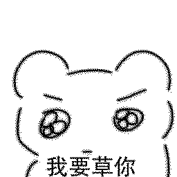

# 玄砚 × 阿毛 · 表情包仓库

聊天斗嘴专用的表情包收藏夹。图片文件保存在 `stickers/`，可通过 GitHub 原始图片链接直接引用。

## 第一张表情

## 使用

- 表情包清单：[`index.json`](index.json)，包含 id、标题、标签、图片路径与直链。
- 图片直链格式：`https://raw.githubusercontent.com/tusumy/biaoqing/main/stickers/文件名.png`
- 后续往 `stickers/` 添加 PNG、JPG、WEBP、GIF 即可。给新表情补充标签时修改 `metadata.json`；GitHub Actions 会自动重建 `index.json`。
- 可按标签选择表情：如「嚣张」「挑衅」「撒娇」「反驳」「生气」。我们聊天时我会按场景挑，不用每次让你递图。

> 注：客户端能否将外链直接显示为聊天内图片，取决于当前聊天环境的渲染能力；仓库本身提供的是公开可访问的静态图片地址。
